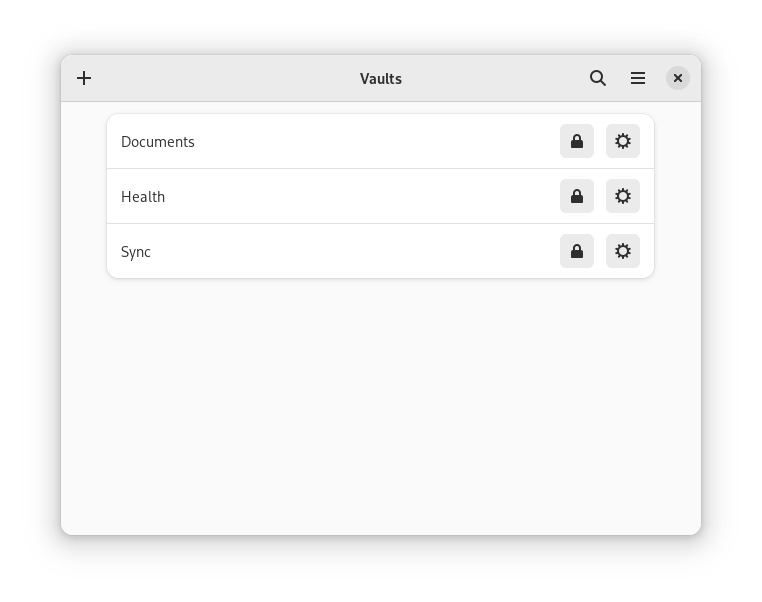

<h1 align="center">
  <br>
  Vaults
</h1>

<p align="center"><strong>Keep important files safe</strong></p>

<p align="center">
 <a href="https://flathub.org/apps/details/io.github.mpobaschnig.Vaults"></a>
</p>

<p align="center">
  
</p>

Vaults lets you create encrypted vaults in which you can safely store files.
It currently uses [gocryptfs](https://github.com/rfjakob/gocryptfs) and [CryFS](https://github.com/cryfs/cryfs/) for encryption.  Please always keep a backup of your encrypted files.

# How to build

The supported way of building Vaults using GNOME Builder (or Visual Studio Code with the Flatpak extension) by cloning the repository and simply building and then running it.

# Testing

The test suite consists of two types of tests: **pure logic tests** (backend, configuration, utilities) and **UI tests** (GTK4 widget signals and state). UI tests require a headless Wayland display server.

## Running the Full Test Suite

### Prerequisites

Install the Weston headless compositor (available on most distributions):

```bash
# Fedora
sudo dnf install -y weston

# Arch Linux
sudo pacman -S weston

# Debian/Ubuntu
sudo apt install weston
```

### Quick Start

Start the Weston headless compositor, then run tests:

```bash
# Start Weston headless
mkdir -p /tmp/weston-runtime
chmod 700 /tmp/weston-runtime
XDG_RUNTIME_DIR=/tmp/weston-runtime weston --backend=headless --renderer=pixman --no-config &

# Wait for the Wayland socket to appear
for i in $(seq 1 30); do
  [ -S /tmp/weston-runtime/wayland-0 ] && break
  [ -S /tmp/weston-runtime/wayland-1 ] && break
  sleep 1
done

# Run all tests
export XDG_RUNTIME_DIR=/tmp/weston-runtime
export WAYLAND_DISPLAY=wayland-0  # or wayland-1
export GDK_BACKEND=wayland
export XDG_SESSION_TYPE=wayland
cargo test

# Stop Weston when done
pkill weston
```

### Running Only Pure Logic Tests

Pure logic tests (backend, configuration, utilities) don't require Weston:

```bash
cargo test backend
cargo test configuration
cargo test util
cargo test vault
```

### Style and Linting Checks

CI runs these commands; all must pass with zero warnings:

```bash
cargo fmt --all -- --check
cargo clippy --all-targets --all-features -- -D warnings
```

# Contributing

Pull requests for bugs or translation updates are welcomed!
However, before working on new features, please open a new topic in [discussions](https://github.com/mpobaschnig/vaults/discussions) or comment on a dedicated [issue](https://github.com/mpobaschnig/vaults/issues), so duplicate efforts can be prevented.
To coordinate accordingly, opening a pull request early as a draft is encouraged to make changes transparent to others.

# Bug reporting

For bug reports, please try to reproduce the issue with additional debug information enabled by running Vaults in the terminal using:

```bash
flatpak run --env=RUST_LOG=trace io.github.mpobaschnig.Vaults
```

When sharing, please be careful of redacting personally identifiable information (PII).

# Translations

Imagery is translated mainly using [Transifex](https://www.transifex.com/mpobaschnig/vaults/). Translations over Github pull requests are also accepted, if you prefer to do so.
